# Invoice Approval & Payment Tracking Automation

An end-to-end invoice processing and payment monitoring system built with **n8n, Google Sheets, n8n Forms, and Telegram**.

The automation handles invoice intake, validation, duplicate detection, approval routing, approval/rejection decisions, payment deadline monitoring, and automated Telegram reminders.

## Overview

The solution is divided into three connected workflows:

1. **Invoice Intake & Validation**
   - Collects invoice data through an n8n Form
   - Validates submitted information
   - Detects duplicate invoices
   - Automatically approves invoices below the approval threshold
   - Routes higher-value invoices for manual approval
   - Stores invoice records in Google Sheets

2. **Invoice Approval Handler**
   - Receives approval decisions through a dedicated approval form
   - Finds the corresponding pending invoice
   - Supports both approval and rejection
   - Updates invoice status and approval information in Google Sheets

3. **Payment Due Reminder**
   - Runs automatically on a schedule
   - Checks approved invoices and payment due dates
   - Detects invoices that are due soon, due today, or overdue
   - Sends Telegram notifications
   - Tracks reminder status in the invoice register

---

## Workflow 1 — Invoice Intake & Validation

### Pending Approval

Invoices above the configured approval threshold are routed to manual approval.

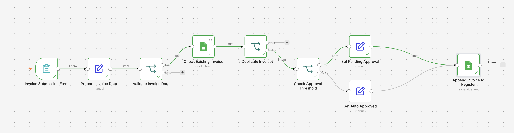

The invoice is stored in the register with the status `Pending Approval`.

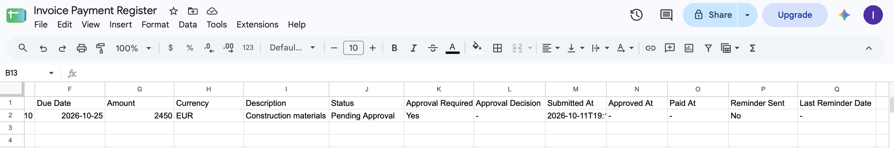

### Automatic Approval

Invoices below the approval threshold are approved automatically.

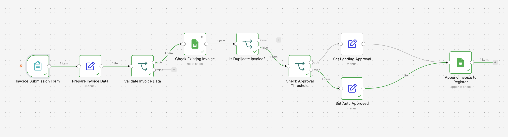

The result is stored in Google Sheets with `Auto Approved` as the approval decision.

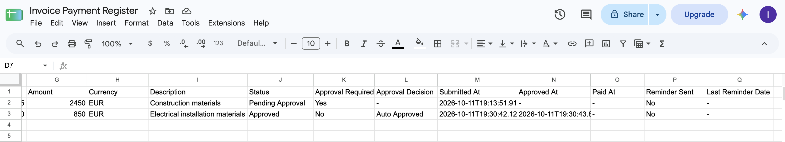

### Duplicate Detection

The workflow checks existing invoice records before creating a new entry.

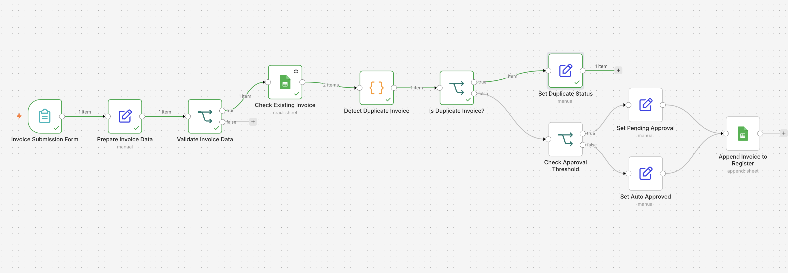

If a duplicate is detected, processing stops and the invoice is marked accordingly.

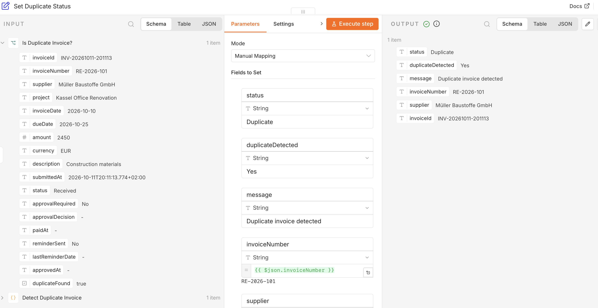

---

## Workflow 2 — Invoice Approval Handler

Pending invoices can be reviewed through a dedicated approval form.

The approval workflow identifies the invoice, validates its current status, processes the decision, and updates the register.

### Approved Invoice

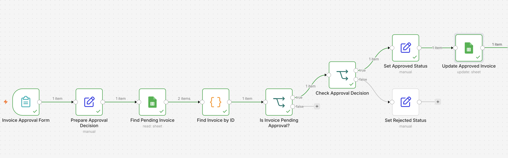

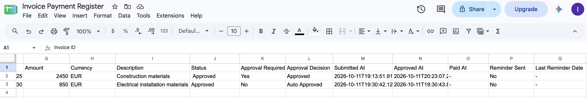

### Rejected Invoice

The same workflow also supports invoice rejection.

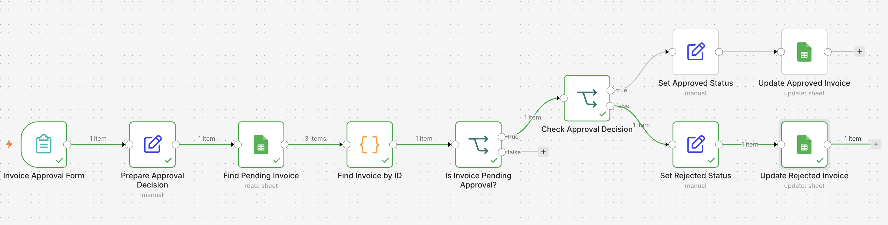

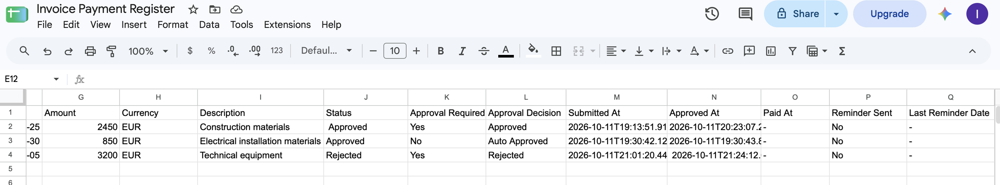

---

## Workflow 3 — Payment Due Reminder

A scheduled workflow monitors approved invoices and evaluates their payment deadlines.

### Due Soon & Due Today

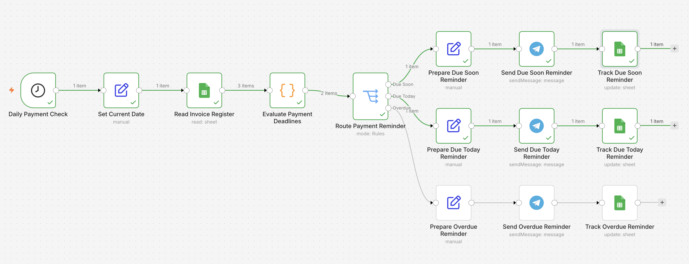

Telegram reminders are generated automatically for invoices approaching their due date.

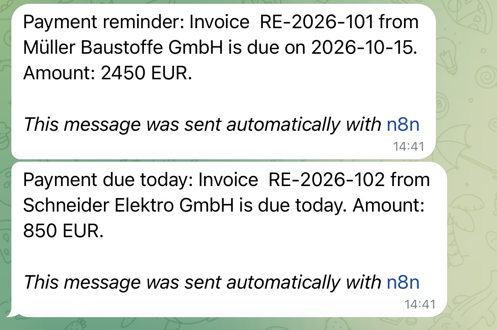

The workflow records that a reminder has been sent and stores the reminder date.

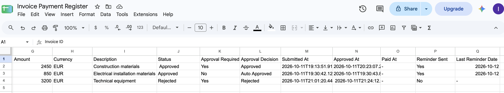

### Overdue Payments

Overdue invoices are detected separately and generate a dedicated alert.

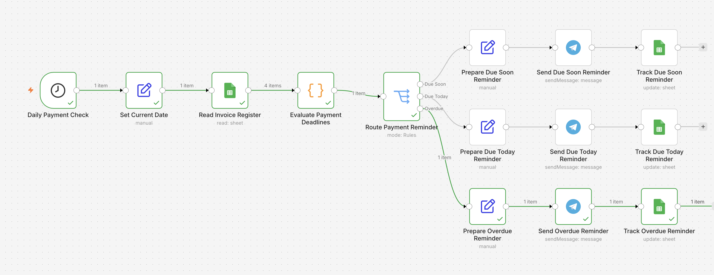

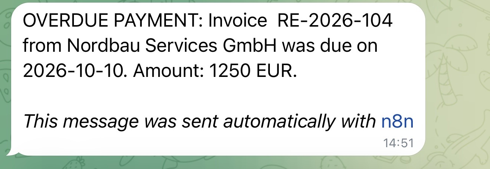

Reminder information is then updated in Google Sheets.

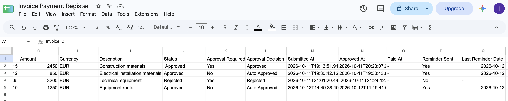

---

## End-to-End Approval Example

For invoices requiring manual approval, the workflow sends a Telegram notification containing the invoice details, Invoice ID, and a link to the approval form.

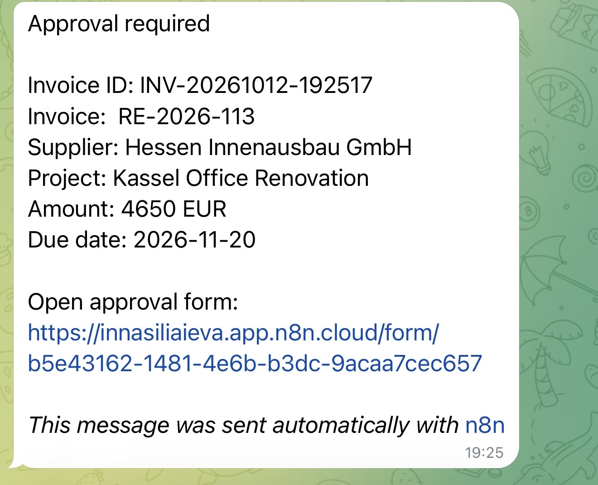

The manager reviews the invoice and submits an approval or rejection decision.

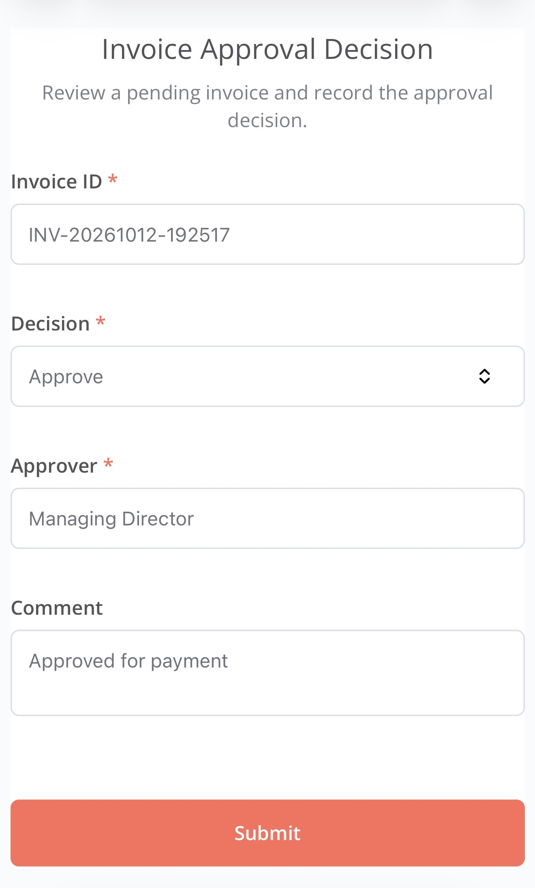

The invoice register is automatically updated after the decision is processed.

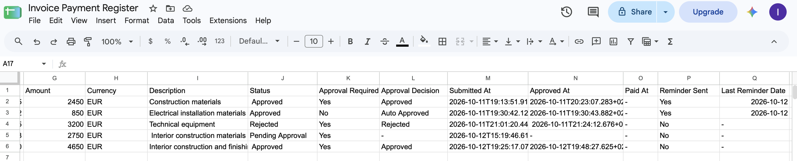

---

## Key Features

- Invoice submission through n8n Forms
- Data validation before processing
- Duplicate invoice detection
- Configurable approval threshold
- Automatic approval for lower-value invoices
- Manual approval and rejection workflow
- Central invoice register in Google Sheets
- Scheduled payment deadline monitoring
- Due Soon, Due Today, and Overdue classification
- Automated Telegram notifications
- Reminder tracking to prevent duplicate alerts
- Production-ready multi-workflow architecture

## Technologies

- **n8n**
- **Google Sheets**
- **Telegram Bot API**
- **n8n Forms**
- **JavaScript / Code nodes**
- **Conditional routing and scheduled workflows**

## Workflow Architecture

```text
Invoice Submission
        ↓
Validation & Duplicate Check
        ↓
Approval Threshold
   ↙               ↘
Auto Approved    Pending Approval
                     ↓
              Telegram Notification
                     ↓
               Approval Form
                     ↓
             Approve / Reject
                     ↓
            Google Sheets Update
                     ↓
              Payment Monitoring
                     ↓
      Due Soon / Due Today / Overdue
                     ↓
            Telegram Reminders
```

## Use Case

This automation can be adapted for small and medium-sized businesses that need a structured process for:

- invoice registration,
- approval control,
- payment deadline monitoring,
- financial document tracking,
- and automated internal notifications.

---

> Demo data is used in the screenshots. Credentials, tokens, and private configuration values are not included in the public repository.
